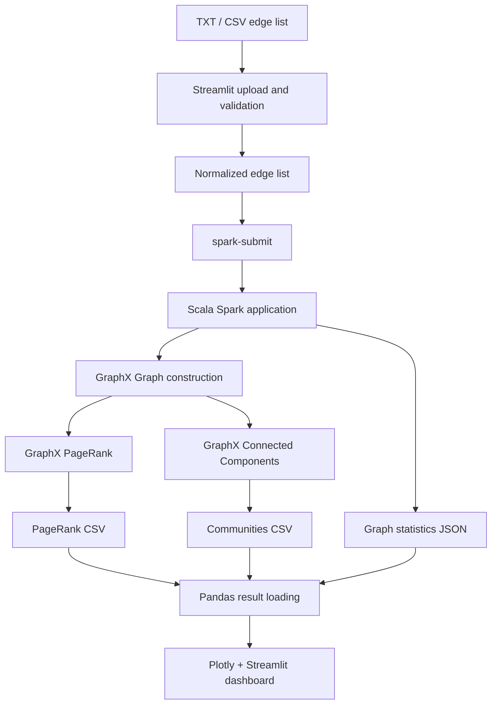
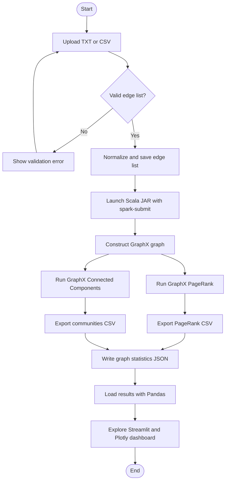

# Social Network Analyzer using Apache Spark GraphX

**Big Data Essentials · Project 30**  
A local-first college project that analyzes social relationship edge lists with genuine Scala + Apache Spark GraphX PageRank and Connected Components, then presents the exported results in Streamlit and Plotly.

> **Important execution guarantee:** Python does not calculate PageRank or Connected Components. The Scala source calls `Graph.pageRank(0.0001)` and `Graph.connectedComponents()` from Spark GraphX. The dashboard refuses to label results as GraphX unless the Spark process succeeds and writes its output files. This repository has not been executed on your Windows machine; follow the verification steps below.

## Abstract
Social networks can be represented as graphs in which users are vertices and relationships are edges. This project uses Apache Spark GraphX to construct a graph from an uploaded edge list, rank influential users using PageRank, and identify connected groups using Connected Components. A Streamlit dashboard provides interactive network exploration, rankings, community summaries, and user-level details. Spark runs in local mode, making the project suitable for a normal Windows laptop without a distributed cluster.

## Introduction
Graph processing reveals structural properties that are difficult to inspect in raw relationship tables. PageRank estimates the relative structural importance of vertices, while Connected Components identifies vertices connected by paths. GraphX provides these algorithms on Spark's distributed graph-processing abstraction.

## Problem Statement
Given a set of social-network relationships, manually identifying influential users and disconnected groups is difficult and does not scale well. The project automates these two graph analyses and makes their results explorable.

## Objectives
1. Construct a graph from a TXT/CSV edge list using Spark GraphX.
2. Calculate user influence using GraphX PageRank.
3. Identify connected groups using GraphX Connected Components.
4. Visualize influential users and component structures.
5. Allow users to inspect a user's rank, community, degree, and direct neighbors.

## Existing System
A basic spreadsheet or static report can list relationships but does not iteratively calculate graph influence or connectivity, and offers limited interactive exploration.

## Proposed System
A Streamlit interface validates data and launches a Scala Spark application. GraphX constructs the graph and executes the two algorithms. The backend exports CSV/JSON files that Pandas reads and Plotly visualizes.

## Technologies Used
- Apache Spark 3.5.3 and Spark GraphX 3.5.3
- Scala 2.12.18; sbt 1.10.7
- Java JDK 17
- Python 3.11, Streamlit 1.41.1, Pandas 2.2.3, Plotly 5.24.1, NumPy 2.1.3
- VS Code (recommended editor)

## System Architecture


## Project Workflow Flowchart


## Methodology
1. Upload TXT or CSV. Each record contains source and target user IDs.
2. Validate two non-empty IDs per row; remove self-links and duplicate undirected edges.
3. Scala reads the normalized edge list with Spark, assigns each external user ID a GraphX `Long` ID, and constructs `Graph[Int, Int]`.
4. Run `graph.pageRank(0.0001)` and `graph.connectedComponents()` in GraphX.
5. Export `pagerank_results.csv`, `communities_results.csv`, and `graph_stats.json`.
6. Streamlit loads the exported results and presents interactive charts and exploration tools.

### PageRank algorithm explanation
PageRank models a random walk over the graph. A vertex receives rank from linked vertices; vertices connected to highly ranked vertices can receive greater rank. The damping/reset probability prevents rank from becoming trapped in graph structures. GraphX iterates until the requested tolerance is met. This project uses GraphX's built-in PageRank implementation with tolerance 0.0001.

**Pseudocode:**
```text
INPUT: Graph G, tolerance ε = 0.0001
R ← GraphX PageRank(G, ε)
FOR each vertex v:
    output (external_user_id(v), R[v])
SORT output by score descending
```

### Connected Components explanation
A connected component is a maximal set of vertices where every pair is connected by some path. GraphX's algorithm assigns the same component label to all vertices in a connected component. The exported component ID is mapped back to an external user ID. These are connectivity components, not community-detection clusters based on modularity.

**Pseudocode:**
```text
INPUT: Graph G
C ← GraphX ConnectedComponents(G)
FOR each vertex v:
    output (external_user_id(v), external_user_id(C[v]))
COUNT vertices per component label
```

## Dataset Description
The included `data/sample_edges.txt` is **synthetic**, generated for this project. It contains 60 user IDs arranged in three disconnected dense groups and hub-like users. It is not real-world Facebook data and has no personal information. See `data/dataset_info.json`.

### Optional real dataset
The Stanford SNAP Facebook ego-network dataset is available at: https://snap.stanford.edu/data/ego-Facebook.html . Download the `facebook_combined.txt` edge list (or an equivalent edge-list file), preserve the source attribution, and upload it through the dashboard. The SNAP file contains real network data collected for research; follow the source's terms and cite the SNAP dataset page/paper. The application treats relationships as undirected and removes duplicate pairs.

### Importing your own data
- TXT: `userA userB`, `userA,userB`, or tab-separated pairs, one edge per line.
- CSV: at least two columns; preferred headers are `source,target`.
- User IDs may be strings or numbers. They are mapped to GraphX's required Long IDs internally.
- Self-links and duplicate undirected edges are removed. Isolated users that never appear in an edge are not represented by an edge-list-only input.

## Implementation
- `app.py`: upload, validation, Spark process launch, result loading, dashboard and Plotly graph.
- `spark/src/main/scala/com/socialanalyzer/SocialNetworkAnalyzer.scala`: actual GraphX graph and algorithms.
- `spark/build.sbt`: Spark/GraphX dependencies, Scala version and packaging.
- `scripts/run_graphx.bat`: backend build/run helper.
- `START_PROJECT.bat`: creates Python venv, installs dependencies, builds the Scala JAR if absent, and launches Streamlit.

### How Scala communicates with Python
The dashboard saves the validated edge list to `input/current_edges.csv`, launches the compiled Scala JAR through `spark-submit`, and passes the input and output directory paths as command-line arguments. Scala writes CSV and JSON results into `output/`. The Python dashboard reads those files with Pandas. This is a simple, inspectable file-based interface.

## Windows Setup (beginner-friendly)
Install these exact compatible versions. Use x64 installers where offered.

1. **Python 3.11.x:** https://www.python.org/downloads/release/python-3119/ . During setup tick **Add python.exe to PATH**.
2. **Java JDK 17:** Eclipse Temurin 17: https://adoptium.net/temurin/releases/?version=17 . Set `JAVA_HOME` to the JDK installation directory, e.g. `C:\Program Files\Eclipse Adoptium\jdk-17...`, and add `%JAVA_HOME%\bin` to PATH.
3. **Apache Spark 3.5.3:** https://archive.apache.org/dist/spark/spark-3.5.3/spark-3.5.3-bin-hadoop3.tgz . Download `spark-3.5.3-bin-hadoop3.tgz`, extract with 7-Zip to `C:\spark\spark-3.5.3-bin-hadoop3`. Set `SPARK_HOME=C:\spark\spark-3.5.3-bin-hadoop3` and add `%SPARK_HOME%\bin` to PATH. Spark 3.5.3 supports Java 17. A Hadoop winutils installation is not normally needed for this local-mode project; if your Spark distribution reports a Windows Hadoop native error, consult the Spark/Hadoop Windows setup notes rather than downloading arbitrary binaries.
4. **sbt 1.10.7:** https://github.com/sbt/sbt/releases/tag/v1.10.7 . Install the Windows MSI for sbt 1.10.7 and ensure `sbt` is on PATH. sbt downloads the matching Scala compiler and Spark compile dependencies during the first build.
5. **VS Code:** https://code.visualstudio.com/ . Open this project folder. Optional extensions: Scala (Metals) and Python.

Open a new PowerShell terminal after setting environment variables and verify:
```powershell
java -version
python --version
sbt --version
spark-submit --version
```
Expected major versions: Java 17, Python 3.11, sbt 1.10.7, Spark 3.5.3.

### Install Python dependencies
From the project root:
```powershell
py -3.11 -m venv .venv
.venv\Scripts\Activate.ps1
python -m pip install --upgrade pip
pip install -r requirements.txt
```
If PowerShell blocks activation, use `Set-ExecutionPolicy -Scope Process -ExecutionPolicy Bypass` in that terminal, or activate from Command Prompt with `.venv\Scripts\activate.bat`.

### Build the Scala GraphX application
```powershell
cd spark
sbt clean package
cd ..
```
The JAR should appear at `spark\target\scala-2.12\social-network-graphx_2.12-1.0.0.jar`.

### Run GraphX directly (recommended first test)
From the project root:
```powershell
spark-submit --class com.socialanalyzer.SocialNetworkAnalyzer --master local[*] --conf spark.driver.memory=2g spark\target\scala-2.12\social-network-graphx_2.12-1.0.0.jar data\sample_edges.txt output
```
A successful execution prints `GRAPHX_SUCCESS`. Confirm all three output files exist in `output\`. Then run `python scripts\verify_graphx_outputs.py`; it checks output schemas, row counts and engine metadata. This validates the produced files, while the Scala source and Spark execution log establish the GraphX computation path.

### Launch the dashboard
```powershell
.venv\Scripts\Activate.ps1
streamlit run app.py
```
Open the local URL printed by Streamlit (normally http://localhost:8501). Select the sample dataset or upload your own, then click **Run Spark GraphX Analysis**. The dashboard invokes the same Scala JAR and reloads its output.

### One-click start
After installing JDK 17, Python 3.11, Spark 3.5.3 and sbt, double-click `START_PROJECT.bat`. It creates the venv, installs Python packages, builds the JAR if missing, and starts Streamlit. The first run requires internet access for package downloads.

## Output files and expected results
- `pagerank_results.csv`: `user_id,pagerank,degree` sorted by PageRank descending.
- `communities_results.csv`: `user_id,component_id` for each vertex.
- `graph_stats.json`: vertex count, edge count, component count, engine name and component sizes.
- `spark_run.log`: captured Spark process log from dashboard runs.

The synthetic sample has 60 distinct users. The three disconnected dense groups should produce three connected components; the hub-like vertices should rank relatively highly within their groups. Exact PageRank values depend on the input graph and GraphX algorithm implementation. Never use expected values as proof of execution: use the successful `GRAPHX_SUCCESS` log and output files.

## Results and Screenshots Guidance
For your report, capture: (1) Overview with vertex/edge/component metrics and top five users; (2) Network Visualization with colored components; (3) PageRank top-ten bar chart; (4) Connected Components size chart and selected community; (5) User Explorer showing degree, PageRank, component ID and neighbors; (6) terminal showing `GRAPHX_SUCCESS`. Do not claim a Spark run if this marker is absent.

## Advantages
- Uses actual Spark GraphX algorithms.
- Runs in local mode on a single laptop.
- Accepts user-provided edge lists and string IDs.
- Separates compute backend from dashboard.
- Interactive exploration and CSV exports.

## Limitations
- Local mode uses one computer and its available memory/CPU; it is not a multi-node cluster demonstration.
- Results are collected to the driver for CSV export and interactive visualization, so very large graphs can exceed laptop memory.
- Edge-list input cannot represent isolated users unless the input format is extended with a separate vertex list.
- Connected Components identifies path-connected groups, not overlapping or modularity-based communities.
- The dashboard graph view limits visible nodes for browser performance; algorithm execution still processes the full uploaded graph.
- Directed follower relationships are treated as undirected for the connected-components social network model.

## Future Scope
- Add a separate vertex file to represent isolated users.
- Add directed-graph analysis and configurable PageRank iterations.
- Add distributed Spark cluster deployment and larger-scale benchmarking.
- Add temporal network analysis and additional graph metrics while preserving the core GraphX pipeline.
- Add richer community algorithms as a separately labelled extension.

## Conclusion
The project models social relationships as a graph and applies Spark GraphX PageRank and Connected Components to identify influential vertices and connected groups. Streamlit and Plotly provide a user-friendly interface for exploring the Scala backend's exported results.

## References
1. Apache Spark GraphX Programming Guide: https://spark.apache.org/docs/3.5.3/graphx-programming-guide.html
2. Apache Spark 3.5.3 Documentation: https://spark.apache.org/docs/3.5.3/
3. Stanford SNAP Facebook dataset: https://snap.stanford.edu/data/ego-Facebook.html
4. Page, L. et al. (1999). The PageRank Citation Ranking: Bringing Order to the Web.
5. Connected Components and graph processing concepts: Apache Spark GraphX documentation above.

## 15 Viva Questions and Answers
1. **What is Apache Spark?** A distributed data-processing engine designed for large-scale computation, with APIs for batch, streaming, SQL and graph workloads.
2. **What is GraphX?** Spark's graph-processing API that represents graphs using vertices and edges and provides graph algorithms.
3. **Why represent a social network as a graph?** Users are naturally vertices and relationships are edges, so connectivity and influence can be analyzed structurally.
4. **What is a vertex?** A node in a graph; here, one social-network user.
5. **What is an edge?** A relationship between two vertices; here, a connection between users.
6. **What does PageRank measure?** Relative structural importance based on the rank contributions of linked vertices; it is not simply the number of friends.
7. **Why can a user with fewer connections have a high PageRank?** Their connections may come from highly ranked users, which can contribute more rank than many low-ranked connections.
8. **What is damping in PageRank?** A reset probability in the random-surfer model that prevents rank from remaining trapped in link structures.
9. **What is a connected component?** A maximal set of vertices in which every pair is connected by some path.
10. **Does one connected component mean all users are directly connected?** No. They only need to be connected through a path; they may not have direct edges to one another.
11. **Are connected components the same as communities?** Not exactly. They are connectivity groups, while many community-detection methods use density/modularity and can split a connected component.
12. **Why use Scala?** Spark and GraphX have a native Scala API, so Scala provides direct access to GraphX graph types and algorithms.
13. **Why is GraphX VertexId a Long?** GraphX uses a 64-bit integer identifier for vertices; this project maps original string IDs to Long IDs and restores them in outputs.
14. **How does Python communicate with Scala?** Streamlit writes the edge list, launches the compiled Scala JAR using spark-submit, and reads the resulting CSV/JSON files.
15. **How do you prove the algorithms ran in GraphX?** Show the Scala calls to `graph.pageRank(...)` and `graph.connectedComponents()`, the Spark-submit command, the `GRAPHX_SUCCESS` log, and the generated result files.
